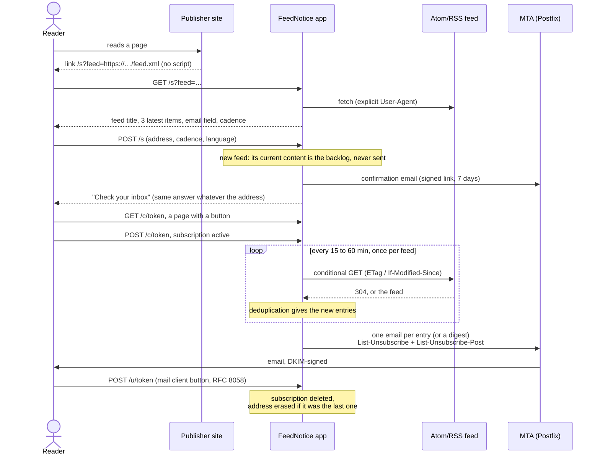
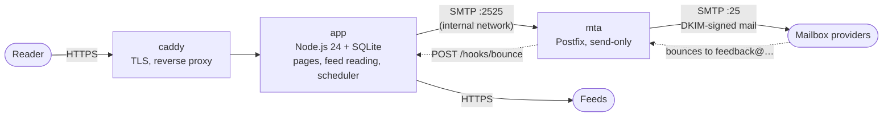
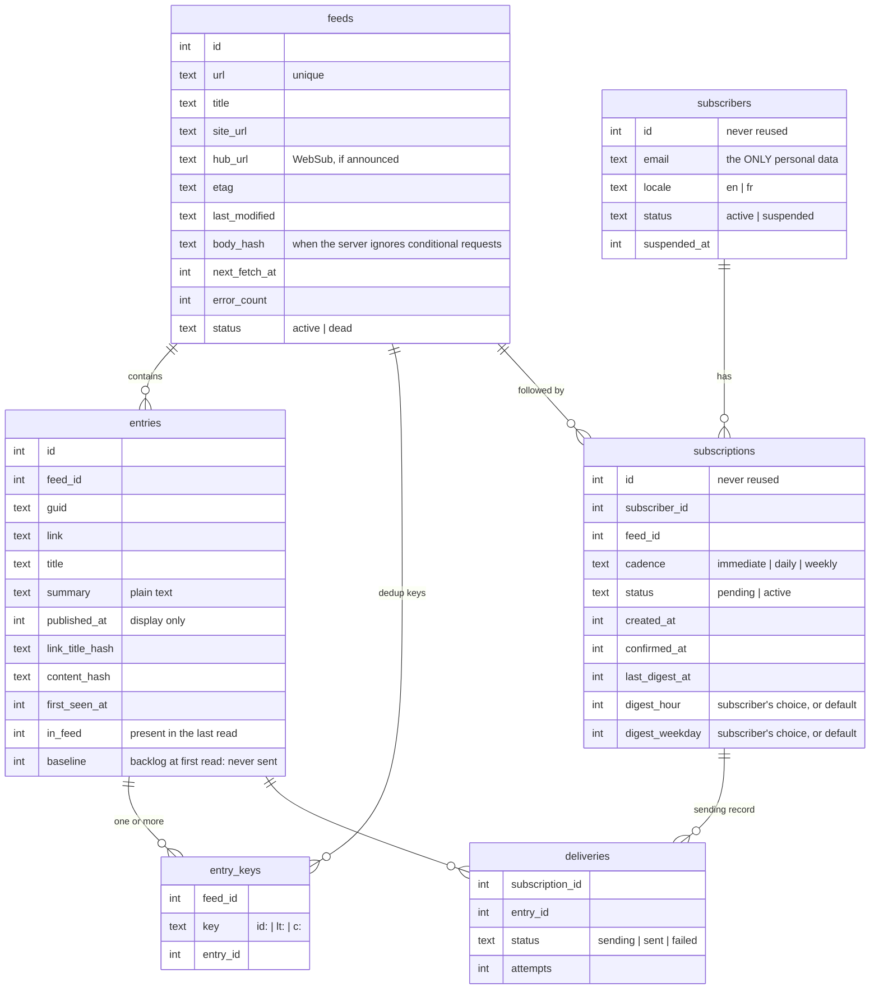

# FeedNotice — design

## 1. The product in one sentence

Someone clicks "Get updates by email" next to an Atom or RSS feed, sees what they are about to
follow, enters their address and confirms. From then on they receive each new entry, or a daily
or weekly digest. No account, no password, no tracking. Any feed works.

## 2. Journey

Choices worth explaining:

- **A button behind every link** (confirm, unsubscribe). Antivirus software and mail gateways
  open the links in emails to inspect them. A link that acted on GET would confirm
  subscriptions nobody asked for and unsubscribe people behind their back. GET shows a page;
  only POST acts. The header unsubscribe (RFC 8058) is a POST: it acts without an intermediate
  page, as Gmail and Yahoo require.
- **What is sent after confirmation**: the entries that appeared since the *request*. Nothing
  leaves before the click; what was published between the request and the click leaves right after.
- **Account page**: the address receives a link valid for 24 hours that lists its subscriptions.
  There the subscriber changes the cadence, the digest time and day, the language, stops a
  subscription or erases everything.
- **Same answers**: the subscribe and account pages answer the same whether the address is known
  or not. They cannot be used to find out who follows what.
- **Languages**: English by default, French available. The language comes from `?lang=`, else
  from the browser (`Accept-Language`); no cookie. It is stored with the subscriber at
  subscription time and used for all their emails. Adding a language means adding one catalog
  file (`src/i18n/`), which TypeScript checks for completeness.

## 3. Architecture

### One server, three containers

- **app**: web pages, feed reading, deduplication, sending, and the scheduler, which runs every
  minute inside the process. It signs DKIM itself. Data lives in one SQLite file on a volume.
- **mta**: Postfix, configured entirely from `.env`. It relays what the app submits on
  port 2525, which is reachable only on the internal Docker network. From the Internet it
  accepts mail for just three addresses:
  - `feedback@` (bounces), whose messages it posts to the app;
  - `postmaster@` and `abuse@`, forwarded to a human.
  It never relays for anyone else, whatever the client's address. Postfix owns the queue,
  retries temporary refusals and spreads the load per destination.
- **caddy**: HTTPS with automatic certificates.

Everything is self-contained: your usual mail server only receives human replies
(`Reply-To`). The sending IP and domain are separate from it, so a bad week for the service
cannot hurt your own mail.

**Scaling later.** More sending capacity means another `mta` on another server with its own IP
(`s2.example.org`), added to the SPF record. The app would then submit to several MTAs, which
is a small change. SQLite on one server holds hundreds of thousands of subscribers. High
availability or several app instances would mean moving to PostgreSQL; that touches `db.ts` and
the queries, not the design. The database lock around each round (`locks` table) already
prevents two processes from sending the same thing.

### Naming

| Name | Role |
|---|---|
| `example.org` | the website |
| `mail.example.org` | the **sending domain**: `From: updates@…`, envelope sender and bounces `feedback@…`, DKIM `d=`, SPF, DMARC. One stable identity, whatever the number of servers |
| `s1.example.org`, `s2.…` | **server names**: A record, PTR (reverse DNS), HELO. One per sending IP |

Per-server names (`s1`, `s2`) are the right tool for machines. They would be the wrong tool as
the From domain: reputation accrues to the domain, subscribers' filters and contacts would see a
different sender per server, and moving traffic between servers would change the sender's
identity.

## 4. Data model

Three side tables hold no cleartext data:

- `suppressions`: HMAC fingerprints of addresses that complained;
- `rate_limits`: rate-limit counters keyed by fingerprints of IP or email addresses, also used
  for the sending caps, erased after two days;
- `locks`: one round at a time.

No token is stored: confirmation, unsubscribe and account links are signed (HMAC-SHA256) and
carry their expiry.

## 5. Reading feeds and deduplication

### Reading

- **Formats**: Atom 1.0, RSS 2.0 and 0.9x, RSS 1.0 (RDF). Everything else is refused:
  - HTML pages;
  - malformed XML;
  - documents declaring XML entities (protection against "XML bombs").
- **Content**: summaries are reduced from HTML to text, with paragraphs and lists kept and
  images and scripts dropped. Relative links are resolved; any link that is not `http` or
  `https` is dropped.
- **Dates**:
  - ISO 8601, RFC 822 and their common variants, French month names included;
  - an unreadable or absurd date (1970, year 3000) counts as no date;
  - dates are only displayed, never used for deduplication.
- **Politeness toward the server**:
  - conditional requests (`If-None-Match`, `If-Modified-Since`);
  - a hash of the body, so an unchanged feed is not parsed again when the server ignores
    those headers;
  - one read every 15 to 60 min (30 by default), with some jitter; `Cache-Control: max-age`
    and `Retry-After` are honored;
  - exponential backoff on errors, up to 24 h; after 25 consecutive failures the feed is
    declared dead;
  - one read per feed whatever the number of subscribers, and only for feeds with at least one
    confirmed subscriber;
  - a User-Agent that says who reads, pointing to a `/robot` page (what, how often, who to
    contact).
- **Safety**: the service fetches URLs supplied by anyone.
  - It refuses to reach private, local or cloud-metadata addresses (SSRF), checked at
    connection time so DNS rebinding cannot get around it. This also keeps it away from the
    Docker network.
  - It caps size (5 MB), duration (15 s) and redirects (5).
  - It limits previews to 60 per hour per visitor.

### Deduplication: never resend an entry

1. **Primary key**: the declared identifier (`atom:id`, `guid`, `rdf:about`), normalized
   (http and https treated alike, trailing slash ignored); else link + title; else
   title + summary. The date is never part of the key.
2. **Long memory**: a key seen before is a known entry, even if the entry left the feed long
   ago. Keys are kept as long as the feed is followed.
3. **Feeds that rewrite their identifiers** (new CMS, move to https): an entry with an unknown
   key is attached to an entry that disappeared *since the previous read*, when the two share
   link and title, or title and summary. Its new key is kept. Restricting this to the previous
   read avoids mistaking a new entry for an old lookalike (a monthly civil-registry notice, for
   example).
4. **First read**: everything the feed contains is the backlog and is never sent.
5. **At most once**: the delivery record is written and committed *before* sending. If the
   process dies in between, that entry is lost for that subscriber rather than sent twice. A
   failure reported at submission is retried 5 times, 15 min apart.
6. **Bursts**: above 5 new entries at once, an "immediate" subscriber gets a single email.
   Catch-up horizon: 14 days.
7. **One digest per reader**: a subscriber's digests due at the same time (same cadence, hour
   and day) go out as one email, a section per feed, each with its own unsubscribe link. Its
   one-click header (`/u/daily/<subscriber>.<signature>`, or `weekly`) stops that digest, every
   feed it gathers. A digest holding a single feed keeps the feed's own email and headers.

### Dead feeds

After 25 failed reads in a row (about three weeks with the backoff), a feed is declared dead.
Each subscriber gets one email saying so, and what happens next: the feed is still tried once
a day; if it answers again, the subscriptions resume by themselves; after 30 days they end, and
an address left with no subscription is erased (`src/deadfeeds.ts`, `src/purge.ts`). Someone
subscribing to a dead feed that answers again brings it back at once.

Known limit: an entry without an identifier whose title (or, without a link, whose summary) is
later corrected is sent once more. Nothing better is possible without an identifier. Each case
is covered by `test/dedup.test.ts`.

## 6. Deliverability

Running your own MTA makes deliverability your job. What is in place, and what the deployment does:

| Requirement | Where |
|---|---|
| SPF, DKIM, DMARC aligned on the sending domain (Gmail and Yahoo since February 2024, Microsoft since 5 May 2025, from about 5,000 emails/day) | DKIM signed by the app (`dkim-keygen` prints the record); SPF and DMARC records ([deploy.md](deploy.md#dns)) |
| PTR (reverse DNS) matching HELO and A | `MTA_HOSTNAME`, PTR set in the hosting provider's control panel ([deploy.md](deploy.md#1-server)) |
| One-click unsubscribe: `List-Unsubscribe` + `List-Unsubscribe-Post: List-Unsubscribe=One-Click` (RFC 8058), honored within 48 h | every subscription email (`src/mail/render.ts`); immediate |
| Visible unsubscribe link in the body | footer of every email |
| Complaint rate < 0.3% (Gmail aims for < 0.1%) | double opt-in, a From name showing the feed ("Town news via Your Service"), a Reply-To that reaches a human, sign-up for Google Postmaster Tools and Microsoft SNDS/JMRP; the operator is alerted above the limit ([§ 12](#12-operating)) |
| Both unsubscribe headers covered by the DKIM signature | `DKIM_HEADERS` in `src/mail/mailer.ts` |
| Bounces | envelope sender (`BOUNCE_ADDRESS`). Postfix's bounce reports (DSN) and remote bounces go to the app (`/hooks/bounce`), which believes only those that copy back the recipient's secret `X-FeedNotice-Ref` mark. Hard bounce: address suspended, erased after 90 days |
| TLS | outgoing: opportunistic (`smtp_tls_security_level = may`); incoming: offered with a self-signed certificate, enough between MTAs |
| New IP | warm-up caps (`MAIL_MAX_PER_DAY`), raised step by step |
| No pixel, no rewritten link | nothing is added; no third party is involved |

## 7. Anti-abuse

- Double opt-in is mandatory. Until it is done, the only email sent is the confirmation.
- At most 3 confirmation emails per day per address, 20 requests per hour per IP (per /64
  network for IPv6), and `CONFIRM_MAX_PER_HOUR` (300) confirmation emails per hour in total.
  Beyond that, the answer stays the same but nothing is sent.
- Confirmation subjects name the feed's host, not its title: whoever controls a feed cannot
  choose the subject of an email sent to someone else. Feed titles going into a sender name or
  subject lose control and invisible characters, and anything looking like an encoded word.
- Pages that must answer the same whatever the address (subscribe, account, publisher sign-in)
  send their email in the background: the response time does not tell either.
- Feeds are hostile input: every fetch has a total deadline (a server that drips bytes is cut),
  redirects to invalid addresses are refused, compressed bodies cut midway end the request, and
  HTML is reduced to text in linear time. The preview cache keeps no feed body.
- An address that complained is never written to again; only its fingerprint is kept.
- The MTA is not an open relay:
  - port 25 accepts only the bounce, postmaster and abuse addresses;
  - submission (port 2525) is not published outside the Docker network.
- Pages run under a strict content security policy: no script, `form-action 'self'`, no
  framing. `Referrer-Policy: no-referrer` keeps the tokens in URLs from leaking to other sites.
- The bounce hooks are not reachable from the Internet (Caddy answers 404); port 25 refuses
  messages over 1 MB; the `mta` container gets only the settings it needs, not `SECRET`.

## 8. GDPR

What is stored and for how long: [privacy.md](privacy.md). In short:

- **One personal data item**: the email address, used only for sending, on the basis of consent
  collected by double opt-in.
- **Retention**:
  - unconfirmed: erased after 7 days;
  - last subscription stopped: erased immediately;
  - hard bounce: erased 90 days after suspension;
  - complaint: erased, only a fingerprint is kept.
- **No cookie, no tracking**, so no banner. IP addresses are never stored in cleartext.
- **Processor**: the hosting provider, whose server also sends the emails. A data processing
  agreement under article 28 is needed.
- **Publishers** only ever see subscriber counts.

## 9. Publishers

Any feed works without registering. A publisher *may* open a publisher space (`/publishers`,
then a sign-in link by email) to customize the page and see numbers:

- **Sign-in** by magic link, valid 24 hours. The account, whose contact address is personal
  data, is created only when the link is opened. Accounts that never verify a domain are erased
  after 30 days.
- **Domain verification**, either:
  - a file `https://<domain>/.well-known/feednotice.txt` containing
    `feednotice-verification=<token>`;
  - or a DNS record `TXT _feednotice.<domain>` with the same value;
  - rechecked every 30 days; three failures in a row and the proof is lost. Whoever proves a
    domain last holds it: the proof shows who controls the domain *now*.
- **Which feeds**: those whose host is the domain or one of its subdomains; the most specific
  verified domain wins.
- **What they see**: confirmed subscriptions per feed. Never an address, and never a number
  below 5 (shown as "fewer than 5"). The split per cadence is shown only when no column holds a
  small number, since it could otherwise be worked out from the total.
- **What they customize**: name and welcome text, shown on the subscribe page of their feeds,
  only when the feed is served by their domain itself (not reached through a redirect).
- **Terms**: the sign-in form asks to accept the terms of use (`/terms`); opening the link
  records the version accepted (`TERMS_VERSION` in `src/publishers.ts`).
- **A button**: `/publishers?feed=…` prepares a plain link and a styled button (their colour,
  their readers' language, an inline icon): copyable HTML with no script and nothing loaded.
- **Tables** `publishers` (email, name, welcome text, plan, language) and `publisher_domains`
  (domain, token, method, verified and checked dates, failures).

## 10. WebSub

When a followed feed announces a hub (`<link rel="hub">`):

1. the service subscribes, with a callback `/websub/<feed>.<signature>`, a 10-day lease and a
   per-feed secret;
2. it answers the hub's verification of intent for that exact topic only, and renews the lease
   a day before it ends;
3. **pushed content is never trusted**: a notification whose signature (`X-Hub-Signature`)
   matches the secret only moves the feed's next read to now, at most once a minute, through
   the usual fetch, parse and deduplicate path. An unsigned or badly signed notification is
   ignored (answered 202, as the specification asks);
4. such a feed is then read periodically only every 6 hours, as a safety net;
5. a feed that changes hub starts over with the new one;
6. only `https` hubs are used, so the per-feed secret never travels in clear.

## 11. Feed discovery

People often paste a website's address rather than its feed. The page's announced feeds
(`<link rel="alternate" type="application/atom+xml|rss+xml">`, `<base>` honored) are found:
one is used directly, several are offered as a choice, none gives a clear message. The
subscription is always to the feed itself, never to the page.

## 12. Operating

- **`cli.ts doctor`** checks a deployment as mailbox providers will see it: settings, A and PTR
  records, MX, SPF (following `include`), DKIM against the key file, DMARC, outbound port 25,
  HTTPS, and Spamhaus. It changes nothing and sends nothing; it exits with 1 if anything fails.
- **Counters** (`stats_daily`): emails sent, bounces, complaints, subscriptions requested,
  confirmed and stopped, feeds that died, per day. Numbers only. `cli.ts stats` prints them.
- **Daily report** to `OPS_EMAIL` at `OPS_REPORT_HOUR`: yesterday, the last 7 days, the current
  state, and what needs attention.
- **Alerts** to `OPS_EMAIL` (and the log) as soon as today's numbers cross a limit: hard
  bounces above 5% of emails sent, complaints above 0.3%, more than 20% of emails refused at
  submission. Each kind at most every 6 hours.

## 13. What is built

| Done | Not yet |
|---|---|
| Subscribe page with preview (title, three latest items), cadence choice | Publisher logo, welcome text in the confirmation email |
| Double opt-in, signed link valid 7 days, anti-antivirus button | Keyword filters |
| Polite periodic reading, deduplication, per-entry sending, grouped bursts | Admin dashboard (the daily report and `stats` cover the numbers) |
| WebSub: signed callbacks, lease renewal, push triggers a read | More languages |
| Feed discovery from a web page's address | Email provider HTTP API adapter (SMTP relays already work) |
| Daily and weekly digests; time and day chosen by the subscriber; one digest per reader | |
| One-click unsubscribe (body and RFC 8058 headers), address erasure | |
| Dead feeds: subscribers told, daily retries, end after 30 days | |
| Home page, terms of use, publisher button generator | |
| Setup checker (`doctor`), daily report and alerts for the operator | |
| Account page by magic link: cadence, schedule, language, stop, erase | |
| Publisher space: magic-link sign-in, domain proof by file or DNS, name and welcome text, counts never below 5 | |
| English and French pages and emails; language stored per subscriber | |
| GDPR purges, rate limits (100 subscriptions per address), SSRF protection, warm-up caps | |
| Operator branding: name, logo, favicons, colours ([branding.md](branding.md)) | |
| Docker: app, send-only Postfix with bounce loop, Caddy; DKIM keys; backups; schema migrations | |
| Continuous integration: tests on Node 22 and 24, image builds, stack smoke test | |

## Sources

Mailbox provider requirements, checked in September 2026:

- Gmail: support.google.com/a/answer/81126 and /14229414
- Yahoo: senders.yahooinc.com/best-practices/
- Microsoft: summarized by mailgun.com/blog/deliverability/microsoft-sender-requirements/
